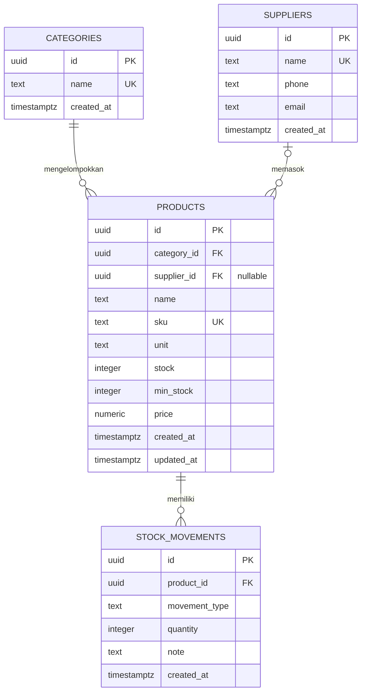

# Dokumentasi Skema Sistem Persediaan Olahraga

## 1. Gambaran umum

Sistem ini mengelola katalog perlengkapan olahraga, pemasok, stok terkini, dan riwayat barang masuk atau keluar. Database menggunakan PostgreSQL pada Supabase. Skema SQL sumber berada di `backend/schema.sql`.

Skema terdiri dari empat entitas:

1. `categories` menyimpan kategori barang.
2. `suppliers` menyimpan data pemasok.
3. `products` menyimpan katalog barang dan jumlah stok terkini.
4. `stock_movements` menyimpan riwayat perubahan stok.

## 2. ERD

### Makna relasi

- **Kategori ke barang: satu ke banyak.** Satu kategori dapat memiliki banyak barang. Setiap barang harus memiliki tepat satu kategori karena `products.category_id` wajib diisi. Kategori yang masih dipakai barang tidak dapat dihapus (`ON DELETE RESTRICT`).
- **Pemasok ke barang: satu ke banyak, opsional pada barang.** Satu pemasok dapat memasok banyak barang. Barang boleh tidak mempunyai pemasok (`supplier_id` bernilai `NULL`). Jika pemasok dihapus, barang tetap ada dan `supplier_id`-nya menjadi `NULL` (`ON DELETE SET NULL`).
- **Barang ke mutasi: satu ke banyak.** Satu barang dapat mempunyai banyak catatan mutasi. Setiap mutasi harus mengacu ke satu barang. Barang yang mempunyai catatan mutasi tidak dapat dihapus (`ON DELETE RESTRICT`).

## 3. Data dictionary

Semua kolom `id` bertipe UUID dan dibuat otomatis menggunakan `gen_random_uuid()`. Kolom waktu menggunakan zona waktu PostgreSQL dan nilai bawaan `now()`.

### `categories`

| Kolom | Tipe | Aturan | Keterangan |
| --- | --- | --- | --- |
| `id` | `uuid` | Primary key | Identitas kategori. |
| `name` | `text` | Wajib, unik | Nama kategori, misalnya Bola atau Raket. |
| `created_at` | `timestamptz` | Default `now()` | Waktu kategori dibuat. |

### `suppliers`

| Kolom | Tipe | Aturan | Keterangan |
| --- | --- | --- | --- |
| `id` | `uuid` | Primary key | Identitas pemasok. |
| `name` | `text` | Wajib, unik | Nama pemasok. |
| `phone` | `text` | Opsional | Nomor telepon pemasok. |
| `email` | `text` | Opsional | Email pemasok. |
| `created_at` | `timestamptz` | Default `now()` | Waktu pemasok dibuat. |

### `products`

| Kolom | Tipe | Aturan | Keterangan |
| --- | --- | --- | --- |
| `id` | `uuid` | Primary key | Identitas barang. |
| `category_id` | `uuid` | FK, wajib | Mengacu ke `categories.id`. |
| `supplier_id` | `uuid` | FK, opsional | Mengacu ke `suppliers.id`. |
| `name` | `text` | Wajib | Nama barang. |
| `sku` | `text` | Wajib, unik | Kode barang. |
| `unit` | `text` | Wajib, default `pcs` | Satuan, misalnya pcs atau pasang. |
| `stock` | `integer` | Wajib, default `0`, minimal `0` | Jumlah stok terkini. |
| `min_stock` | `integer` | Wajib, default `5`, minimal `0` | Ambang untuk penanda stok menipis. |
| `price` | `numeric(14,2)` | Wajib, default `0`, minimal `0` | Harga per satuan. |
| `created_at` | `timestamptz` | Default `now()` | Waktu barang dibuat. |
| `updated_at` | `timestamptz` | Default `now()` | Waktu barang dibuat atau stok diubah oleh trigger mutasi. |

### `stock_movements`

| Kolom | Tipe | Aturan | Keterangan |
| --- | --- | --- | --- |
| `id` | `uuid` | Primary key | Identitas mutasi. |
| `product_id` | `uuid` | FK, wajib | Mengacu ke `products.id`. |
| `movement_type` | `text` | Wajib, hanya `in` atau `out` | Jenis mutasi: barang masuk atau keluar. |
| `quantity` | `integer` | Wajib, lebih dari `0` | Jumlah unit pada mutasi. |
| `note` | `text` | Opsional | Catatan, misalnya pembelian atau penjualan. |
| `created_at` | `timestamptz` | Default `now()` | Waktu mutasi dicatat. |

## 4. Aturan dan alur stok

`products.stock` adalah nilai stok terkini, sedangkan `stock_movements` mencatat perubahan yang terjadi.

Trigger `stock_movement_updates_product` berjalan **sebelum** baris mutasi baru dimasukkan:

- Untuk `movement_type = 'in'`, trigger menambahkan `quantity` ke `products.stock`.
- Untuk `movement_type = 'out'`, trigger mengurangi stok hanya jika jumlahnya mencukupi.
- Jika stok tidak cukup, trigger membatalkan mutasi dengan pesan `Stok tidak mencukupi untuk mutasi keluar.`
- Setiap perubahan stok melalui trigger memperbarui `products.updated_at`.

Perubahan stok dan catatan mutasi berada dalam transaksi database yang sama. Jika trigger menolak perubahan, insert mutasi ikut gagal.

### Penambahan barang dengan stok awal

Aplikasi menjalankan urutan berikut:

1. Membuat atau menggunakan kategori dan pemasok.
2. Membuat barang dengan stok awal `0`.
3. Jika stok awal lebih dari nol, memasukkan mutasi `in` dengan catatan `Stok awal`.
4. Trigger menambahkan jumlah tersebut ke stok barang.

Cara ini memastikan stok awal tercatat dalam riwayat, bukan hanya mengubah angka stok tanpa catatan.

## 5. Indeks dan batasan data

- `categories.name`, `suppliers.name`, dan `products.sku` memiliki batasan unik.
- Foreign key diberi indeks pada `products.category_id`, `products.supplier_id`, dan pasangan `stock_movements.product_id, created_at DESC`.
- Batasan `CHECK` mencegah stok, stok minimum, harga, dan jumlah mutasi bernilai negatif atau tidak valid.
- `pgcrypto` diaktifkan agar fungsi UUID tersedia pada instalasi Supabase yang memerlukannya.

## 6. Akses dan RLS

Row Level Security (RLS) diaktifkan pada seluruh tabel. Role `authenticated` mendapat izin penggunaan schema `public` dan operasi `SELECT`, `INSERT`, `UPDATE`, serta `DELETE`. Policy memberi izin tersebut kepada setiap pengguna yang sudah login.

**Model akses saat ini menggunakan satu ruang persediaan bersama:** setiap akun yang login dapat melihat dan mengelola seluruh kategori, pemasok, barang, serta mutasi. Skema belum memiliki kolom pemilik seperti `user_id` atau pembatas data per organisasi. Jangan gunakan policy ini sebagai isolasi antarperusahaan; tambahkan ownership dan policy berbasis pengguna/tenant jika data perlu dipisahkan.

Frontend hanya menggunakan publishable key bersama access token dari Supabase Auth. Service-role key tidak boleh dimasukkan ke frontend.

## 7. Menerapkan skema

1. Buka proyek Supabase yang benar dan pilih **SQL Editor**.
2. Buka `backend/schema.sql`, salin **seluruh isi file**, lalu jalankan sebagai satu skrip.
3. Pastikan skrip selesai tanpa error. Policy RLS dan grant berada setelah definisi empat tabel.
4. Setelah schema diterapkan, login ke aplikasi dengan akun Supabase Auth. Jika policy atau grant berubah kemudian, jalankan ulang bagian SQL tersebut.

> Skrip membuat tabel bila belum ada dan membuat ulang trigger/policy dengan nama yang ditentukan. Perubahan definisi pada tabel yang sudah ada tidak otomatis dimigrasikan oleh `CREATE TABLE IF NOT EXISTS`; gunakan migration `ALTER TABLE` terpisah bila struktur tabel lama berbeda.
